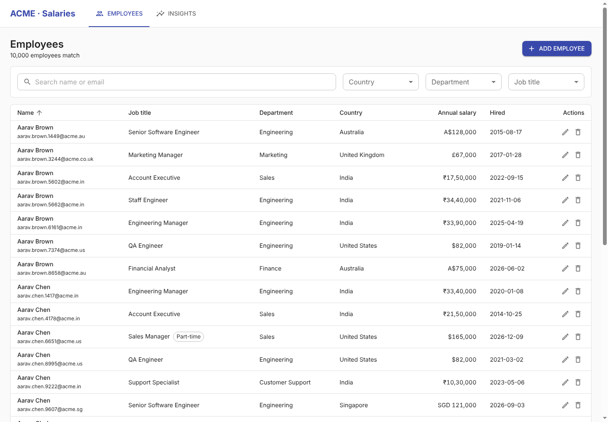
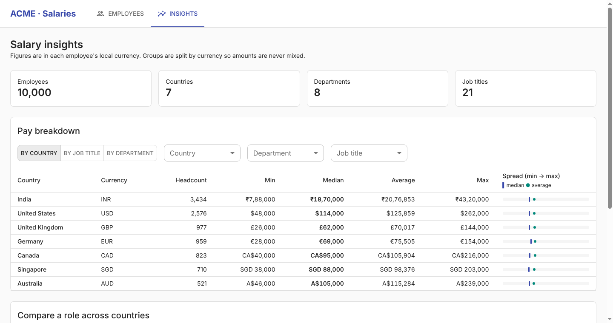

# ACME Salary Management

A web app that lets ACME's HR Manager manage salary records for **10,000 employees across 7 countries** and answer "how do we pay people?" without spreadsheets.

**Live demo:** https://salary-management-coral.vercel.app · **Video walkthrough (74 s):** [docs/demo.mp4](docs/demo.mp4)

**Stack:** React 19 + TypeScript + Material UI + React Query · Node 22 + Express 5 + TypeScript · SQLite (better-sqlite3) · zod · Vitest + Testing Library + Supertest

## Features
- **Employee directory:** server-side paginated, sortable table with search (name/email) and filters (country, department, job title)
- **Add / edit / delete** with validation on both client and server, unique email check, currency auto-filled from the country
- **Salary insights:** headcount, min, median, average and max, grouped by country, job title or department, with filters and a spread bar
- **Role across countries:** e.g. Senior Software Engineer pay in India vs Germany, each in local currency
- **Deterministic seed** of 10,000 realistic employees (~100 ms)

## Quick start
```bash
npm install
npm run seed     # optional: (re)creates server/data/salary.db with 10,000 employees
npm run dev      # API on :4000, UI on :5173 (proxies /api)
```
The server also seeds automatically on first boot if the database is empty.

**Production build (one process serves API + UI):**
```bash
npm run build && npm start   # http://localhost:4000
```

**Deploy on Vercel:** import the repo in Vercel; `vercel.json` sets everything up. The React app is served as static files and the Express API runs as one serverless function (`api/index.mjs`).
> Note: Vercel functions only have a temporary `/tmp` disk, so the demo database is re-seeded with the same 10,000 employees on each cold start. Edits persist while an instance stays warm. For real use, point the repository layer at a hosted database (e.g. Postgres or Turso).

**Docker / Render (persistent single server):** `docker build -t salary . && docker run -p 4000:4000 salary`, or deploy `render.yaml` as a Render Blueprint.

## Tests
```bash
npm test
```
- **Server (31 tests, < 1 s):** repository, service rules, seed generator and HTTP API, each test on a fresh in-memory SQLite database (no SQL mocks).
- **Client (20 tests):** formatting, form validation, and directory/insights flows with a mocked `fetch`.

## API
| Method | Path | Purpose |
|--------|------|---------|
| GET | `/api/employees?page&pageSize&search&country&department&jobTitle&sortBy&sortDir` | Paginated list |
| GET | `/api/employees/:id` | One employee |
| POST | `/api/employees` | Create (400 on validation error, 409 on duplicate email) |
| PUT | `/api/employees/:id` | Update |
| DELETE | `/api/employees/:id` | Delete (204) |
| GET | `/api/insights?groupBy=country\|jobTitle\|department&country&department&jobTitle` | Salary stats per group and currency |
| GET | `/api/meta/facets` · `/api/meta/summary` | Filter options · org totals |

## Project structure
```
docs/            requirements, design notes and trade-offs, AI workflow and prompts
server/src/
  db/            connection + schema, seed CLI
  domain/        types, zod schemas, errors, seed generator (pure)
  repositories/  all SQL
  services/      business rules
  routes/        HTTP + validation
  app.ts         composition root (DB injected → easy testing)
client/src/
  api/           typed API client
  features/      employees/, insights/
  components/    shared filter controls
```

## Docs
- [Requirements (one page)](docs/01-requirements.md): scope and what's deliberately left out
- [Design notes](docs/02-design.md): architecture diagram, trade-offs, performance numbers
- [AI workflow](docs/03-ai-workflow.md): how AI tools were used, key prompts, where I overrode them

## Screenshots


