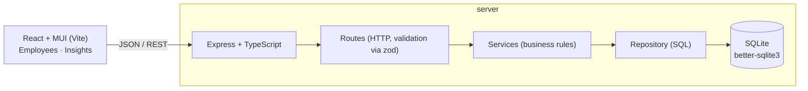

# Design Notes

## Architecture

Single deployable: in production Express serves the built React app from `client/dist`, so there is one URL, one process, no CORS.

## Layering
| Layer | Responsibility | Tested by |
|-------|----------------|-----------|
| `routes/` | Parse + validate input (zod), map errors to HTTP codes | Supertest against an in-memory DB |
| `services/` | Business rules (unique email, not-found handling) | Unit tests |
| `repositories/` | All SQL; parameterised queries; aggregation | Unit tests against `:memory:` SQLite |
| `domain/` | Pure functions: stats (median), seed generator | Pure unit tests |

Dependencies point inwards and the DB handle is injected (`createApp(db)`), so every test gets a fresh in-memory database in milliseconds — fast and deterministic, no mocks of SQL.

## Key decisions & trade-offs
1. **SQLite + better-sqlite3 (synchronous)** — 10k rows is tiny; synchronous driver keeps code simple and is faster than async drivers for this load. Trade-off: single-writer; fine for one HR team. Swap path: the repository is the only SQL-aware layer, so moving to Postgres touches one folder.
2. **Raw SQL over an ORM** — aggregation (median via window functions, GROUP BY with dynamic dimension) is clearer in SQL. Dynamic identifiers (sort column, group dimension) are **whitelisted**, values are always bound parameters.
3. **Server-side pagination, filtering, sorting, aggregation** — the browser never holds 10k rows.
4. **No currency conversion** — insights grouped by country are naturally single-currency. When grouping by job title or department (multi-country), results are additionally split by currency so no number silently mixes INR with USD.
5. **Median in SQL** using `ROW_NUMBER()`/`COUNT()` window functions — avoids pulling salaries into Node.
6. **Deterministic seed** — seeded PRNG (mulberry32) so the same 10,000 employees are produced every run; salaries come from per-country base bands × role-level multipliers with bounded noise, so insights look realistic.
7. **Shared contract** — request/response types live next to zod schemas; the client has its own typed API module.

## Performance considerations
- Indexes: `country`, `department`, `job_title`, `full_name`, unique `email`.
- Seed inserts run in a single transaction with a prepared statement (10k rows in well under a second).
- List queries use `LIMIT/OFFSET` with page size capped at 100; at 10k rows OFFSET cost is negligible. Keyset pagination is the upgrade path past ~1M rows.
- Search uses `LIKE` prefix/contains on indexed columns; FTS5 is the upgrade path if search becomes a bottleneck.

## Upgrade path (v2)
Auth (SSO, viewer/editor roles) → salary change history table → CSV import/export → FX conversion with dated rates → Postgres.

## Measured performance (10,000 seeded rows, laptop-class VM)
| Operation | Avg time |
|-----------|----------|
| Seed 10,000 employees (one transaction) | ~100 ms |
| List page 1 (default sort) | 0.2 ms |
| List with search + salary sort | 2.7 ms |
| Insights grouped by country (incl. median) | 17 ms |
| Insights grouped by job title | 17 ms |
